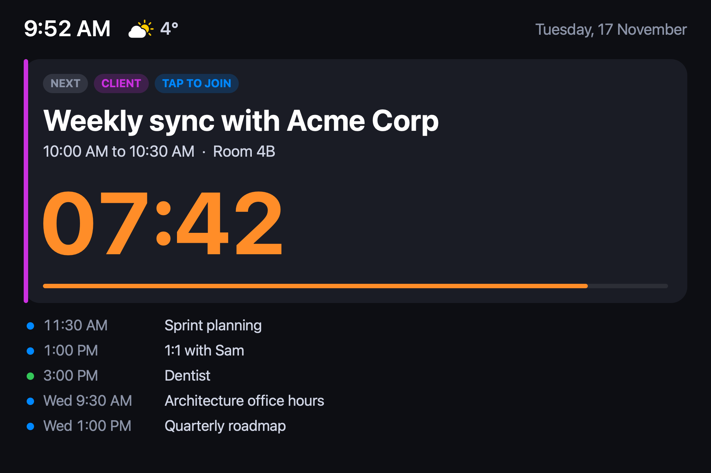
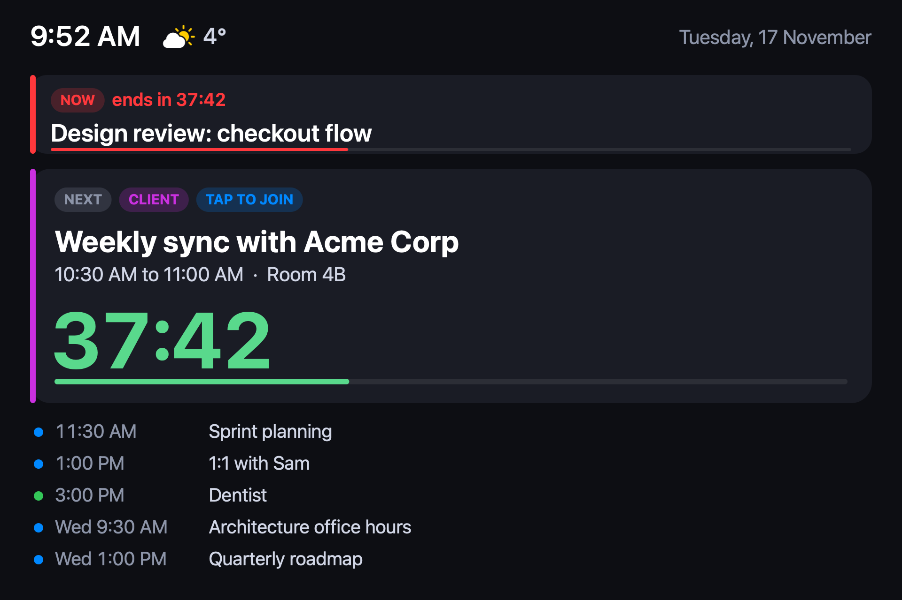

# Meetboard

Your next meeting and a big live countdown, full screen on a spare display beside your Mac.



- Next meeting in large type with a countdown: green, orange under 10 minutes, red under 2.
- When you are already in a meeting, a red strip shows how long it has left, with the next one below.
- Later meetings today and tomorrow, each dot in its calendar's colour.
- Click (or tap, on a touch screen) to join: opens the Teams, Zoom, Google Meet or Webex link from the invite.
- Menu bar icon with a short countdown ("7m", orange under 10 minutes, red under 2) and a menu: join, show or hide the board, open at login, quit.
- Current weather beside the clock (Open-Meteo, no key). Your location is rounded to about 1 km before it is sent; set it by hand with `defaults write com.otbic.meetboard location "43.65,-79.38"`.
- Skips all-day, declined and cancelled events.
- Reads macOS Calendar, so every account you add there shows up together: iCloud, Google, Exchange / Microsoft 365, CalDAV, ICS subscriptions. No sign-in, no cloud, nothing leaves your Mac.
- One Swift file, no dependencies.



## Which screen

Any second display works. The layout is drawn at 960x640 and scales to fit, so a small USB-C or HDMI mini monitor, an old monitor, a TV or an iPad as a Sidecar display all work. It was built on a 7 inch 960x640 mini monitor.

By default Meetboard takes the smallest display that is not your main one. To pick a display by name:

```sh
defaults write com.otbic.meetboard screen "HDMI"   # any part of the name shown in System Settings > Displays
```

With only one display the board starts hidden and Meetboard lives in the menu bar; choose Show Board to bring it up full screen.

## Install

Needs macOS 14 or later and the Xcode Command Line Tools (`xcode-select --install`).

```sh
git clone https://github.com/otbic/meetboard.git
cd meetboard
./build-app.sh --install
```

This builds `Meetboard.app` (ad-hoc signed; if you have a signing certificate, `MEETBOARD_SIGN="Apple Development" ./build-app.sh --install` keeps calendar access across rebuilds), copies it to `/Applications` and opens it. Allow calendar access when asked. The first run from `/Applications` adds it as a login item; turn that off with Open at Login in its menu.

Calendars come from macOS Calendar. To add work accounts: System Settings > Internet Accounts, add the account and turn on Calendars only. If your organisation blocks that, subscribe to the calendar's published ICS link in the Calendar app instead.

Quit: menu bar icon (or right-click the board), Quit Meetboard.

## Try it without your calendar

```sh
build/Meetboard.app/Contents/MacOS/meetboard --demo
```

The screenshots here are made with:

```sh
build/Meetboard.app/Contents/MacOS/meetboard --snapshot docs/screenshot.png
build/Meetboard.app/Contents/MacOS/meetboard --snapshot docs/screenshot-in-meeting.png --scene now
```

## Licence

MIT
